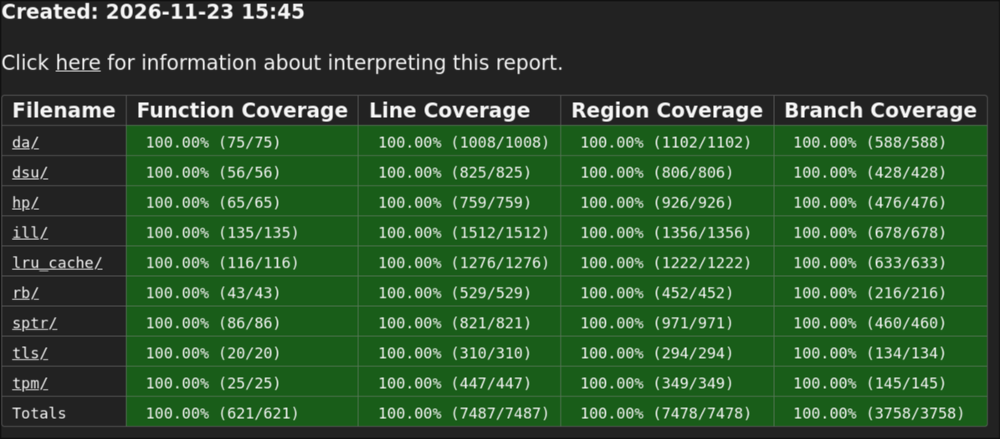

# c_minilibs

A collection of small, dependency-free, header-friendly C libraries.

Each module is an independent mini-library that re-implements a classic data
structure or systems primitive from scratch. The goal is not to ship a polished
framework, but to learn the *why* behind the tools we use every day: exercise
generic C, manual memory management, intrusive designs, concurrency and the
toolchain around them.

Every module ships with its own test suite (allocation/clock failure injection,
coverage, valgrind and static analysis) and can be amalgamated into a single
stb-style header.

## Why

Because the best way to understand a data structure or a threading primitive is
to build it, break it, and then test it again.
This also serves as a primitive to other project hence the `remove_module` rule
in the makefile for quickly removin un-needed dependencies.

## Building

```sh
make                 # compile every module into its own lib<module>.a
make tests           # build every module's test binaries
make tests_run       # build and run tests under valgrind
make coverage        # llvm-cov HTML report in coverage/
make static_analysis # cppcheck over every module
make documentation   # doxygen HTML in documentation/
make single_file MODULE=<module>   # amalgamate one module into single/da.h
```

Targets are module-aware through `MODULE=<name>`, and debug logging is enabled
with `DEBUG_LVL=<level>`.

**Skills:** writing a non-trivial Makefile (metaprogramming the module build
from a template, per-module object trees and dependency files), driving the
LLVM coverage toolchain (`-fprofile-instr-generate` -> `profdata` -> `llvm-cov`),
running tests under valgrind, static analysis with cppcheck, doxygen docs, and
making optional paths (debug logging, fault injection, atomics, threaded tests)
selectable through macros rather than edits.

## Coverage



## Modules presentation

### `common_base`
Shared, zero-dependency building blocks: generic function-pointer typedefs
(callbacks, comparators, duplicators, destructors), the debug logging macros,
small math helpers (including the `CM_FORIT`/`CM_FORRIT` loop-header macros)
and the test harness (malloc/clock wrappers used to inject
allocation and timing failures). **Skill:** designing reusable interfaces for
generic C and building testability into the code from day one.
**Complexity:** not applicable — utility code, no container operations.

### `da` — Dynamic Array
A compile-time-generic growable array (`void *` + element size) with the full
toolbox: create/dup/cat, get/set/add/push/insert/erase/pop/remove, size/capacity/
front/back, reserve/resize, grow/shrink, sort, reverse, fold, filter, find,
apply/apply-range/forward+reverse callback-free element-address iterators
(including `da_it_advance`/`da_it_back`), map and array conversion. **Skill:** manual
memory management and growth strategies, cache-friendly contiguous storage, and
writing algorithms generically over raw bytes.
**Complexity:** `da_add` amortized O(1) (1.5x growth), `da_at`/`da_set` O(1),
middle insert/remove O(n), grow/shrink O(n) (realloc + copy), find/filter/apply
O(n), sort O(n log n).

### `dsu` — Disjoint Set Union
Two complementary flavors: `cdsu` (compact, array-based, path compression and
rank) and `rdsu` (rewindable, logging every union so the structure can be rolled
back), plus conversion routines between them. **Skill:** amortized complexity
analysis (near-constant find/union), union by rank, and designing a
persistent/undoable structure on top of a destructive one.
**Complexity:** `find`/`link` amortized O(α(n)) (inverse Ackermann; path
compression + union by rank). Rewind is O(1) per undone operation.

### `hp` — Heap
A fixed-capacity binary min/max heap driven entirely by a user comparator,
supporting create/init, buffer wrapping (`hp_new_from_array` and
`hp_init_from_array` take ownership of an empty caller buffer), filled-data
construction with O(n) heapify (`hp_{min,max}_{new,init}_from_array`),
push/pop/remove, size-preserving push-pop and replace, peek/at, getters,
structural and order validity checks, duplicate/prefix-duplicate
(`hp_dup`/`hp_ndup`), in-place heapify, for-each (array/pre/in/post plus an
index-aware variant), backing-array iterators (`hp_iter`/`hp_iter_rev` and
advance/back helpers), linear find, fold/reduce, in-place min/max filter, and
map to a positional array of user pointers.
**Skill:** implicit tree layouts in arrays, sift-up/sift-down reasoning,
heapify-from-array O(n) construction, and designing an iterator whose state
stays a plain element pointer.
**Complexity:** push/pop/remove/push-pop/replace O(log n); peek/at O(1);
heapify, duplicate, map, filter, foreach and iterators O(n); find/fold/reduce
O(n). `hp_map` returns a `void **` array preserving backing-array positions,
so `out[i]` is exactly the pointer returned by the mapper for element `i`; it
does not re-heapify the result.

### `ill` — Intrusive Linked Lists
Two variants — singly (`ill`) and doubly (`idl`) linked — where nodes are
embedded *inside* the user's own structs, addressed via an offset, with
push/pop/append/prepend/insert/remove/reverse, apply/napply traversal (with
`_it` variants passing the position and a last-element flag), a pull iterator
and list predicates. The default API is element centric: it takes and
returns the payload struct plus the node offset, so callers do not have to
convert to nodes themselves (including `get_head`/`get_tail`). The low-level
node API is available under the `_node` suffix for mixed payload types or
manual node management; head pointers stay opaque list handles.

A separate circular API (`ill_circ_` / `idl_circ_`) provides the same
intrusive nodes without a `NULL` terminator. Singly circular lists use the
last node as the list handle (`head->next` is the first node), so front and
back insertion are O(1); doubly circular lists keep `head->prev` as the tail.
The circular API exposes length, head/tail access, push/pop at both ends,
concat, remove, clear, foreach and pull iterators (including a reverse
iterator for `idl_circ_`). It deliberately assumes a valid ring and does not
run O(n) validation; mixing a circular list with the non-circular API is a
caller error.
**Skill:** intrusive containers, `offsetof`-style pointer arithmetic, aliasing
the allocation of the payload and its links, O(1) splicing, and ring
invariants.
**Complexity:** front push/pop O(1); `push_back`/`pop_back`/`get_tail` O(n)
without a tail handle; insert O(1); remove given a previously found node O(1)
for `idl` and O(n) for `ill`; `remove_after` O(1); reverse O(n); search O(n);
sort O(n log n). Circular singly: front/back push O(1), front pop O(1),
get_tail O(1) (the handle is the tail), back pop/remove O(n) without a cached
predecessor; circular doubly: all end operations O(1).

### `lh` — List Handler
A facade over the intrusive list types: a `t_cm_lh` stores the first and last
node, the payload offset and a `t_cm_lh_type` enum (`CM_LH_SINGLY`,
`CM_LH_DOUBLY`, `CM_LH_CIRC_SINGLY`, `CM_LH_CIRC_DOUBLY`). The same
`lh_push`/`lh_push_back`/`lh_pop`/`lh_pop_back`/`lh_remove`/`lh_concat`
calls dispatch to the selected implementation, and the cached tail turns
`push_back`, `get_tail` and `concat` into O(1) operations even for singly
linked lists. The handler is element centric and assumes a single node offset
per list; it does not allocate nodes. A future extension may cache a length
or a user tag alongside the head/tail pair.
**Skill:** interface dispatch in C, cached list metadata, and separating
algorithms from the way head/tail are obtained.
**Complexity:** push/pop at the front O(1); `push_back`/`get_tail`/`concat`
O(1) via the cached tail; `pop_back`/`remove` O(1) for doubly and O(n) for
singly; iteration O(n).

### `lruc` — Least Recently Used Cache
A capacity-bounded key/value cache whose bound is enforced by recency: a hash
table for lookup and a doubly linked MRU→LRU list, both pointing at the same
nodes. Offers create/init, put/put_kv, try_get/get (with an on-miss generator),
has, remove, clear (optionally recycling nodes into a reserved list for fast
re-insertion), reserve, stats and hash-order / recency-order for-each. Storing
an entry in a full cache evicts the least recently used one and counts it in the
`expired` stat. A pull iterator walks the recency list in either direction, with
an optional "promote to MRU while walking" mode; both `void *buckets` and the
node links stay internal.
**Skill:** keeping one node consistent across several indexes (hash chain and
recency list), eviction policy, intrusive links and O(1) promotion.
**Complexity:** `put`/`get`/`has`/`remove` expected O(1) (hash bucket lookup,
list splice on hit); lookup with k collisions O(k); eviction O(1) (list tail);
foreach and iterator O(n). Reserve doubles as a node pool to avoid alloc/free
churn.
**Where it pays off:** memoized query results, an HTTP response cache for a
small service, compiled-artifact caches, or the page cache of a toy database.

### `lrutc` — Least Recently Used Timed Cache
The same recency-bounded cache, plus a per-entry time to live: entries are
ordered a second time in a min-heap keyed by expiry, so time-expired entries
can be dropped during `cleanup`, and `has_ttl`/`try_get`/`isexpired` report them
as misses. Supports a cache-wide default ttl (retroactively applied by
`setttl`) and per-put ttls; stats distinguish hits, misses and time-expired
entries. Iteration is offered through hash-order, recency-order and TTL-order
for-each callbacks.
**Skill:** combining a hash table, a linked list and a min-heap over shared
nodes, keeping a second index consistent on insert/remove, and designing around
a monotonic clock.
**Complexity:** `get`/`put`/`has` expected O(1) hash lookup, plus O(log n) to
insert/update/move a node in the TTL heap; `cleanup` O(k log n) for k expiries;
foreach O(n).
**Where it pays off:** DNS resolver caches, sessions/token caches, rate-limit
or negative-cache lookups where stale data must not be served.


### `rb` — Round (Ring) Buffer
A fixed-capacity FIFO spanning a wrap-around buffer, with an optional
`stdatomic` build for lock-free single-producer / single-consumer use.
**Skill:** modular index arithmetic, wrap-around edge cases, and an
introduction to atomics and lock-free reasoning.
**Complexity:** push/pop/peek/at O(1); apply/map/filter O(n); grow O(n) (single
realloc + copy). Atomics build is lock-free SPSC.

### `sptr` — Smart Pointers
Reference-counted pointer types in the spirit of C++ (`uniq`, `owned`,
`strong`, `weak`) backed by a shared metadata "box", with atomic refcounts,
weak counts and destructor ownership; a `_Generic` macro layer gives type-safe
creation/conversion between the categories. **Skill:** reference counting,
ownership models, atomic refcount semantics and thread-safety, and building
type-generic APIs with `_Generic`.
**Complexity:** creation/deref/copy/drop O(1); refcount changes are atomic RMW
O(1).

### `tls` — Thread Local Storage
Three approaches to the same problem: `ctls` (type-safe storage of base C
types), `vtls` (voided/generic key-value storage of arbitrary blobs) and `ftls`
(fastest, compile-time-typed struct with zero lookup overhead) — all built over
`pthread_key_t`. **Skill:** pthread TLS, the speed/flexibility trade-off
between compile-time and runtime typing, and constructor/destructor-driven
lifetime management.
**Complexity:** `ftls` O(1) (compile-time offset, zero lookup); `ctls` O(n)
linear scan bounded by `C_MINI__CTLS_CAP`; `vtls` O(n) linear scan over the
key list.

### `tpm` — Thread Pool Manager
A work-stealing thread pool: a shared job queue with mutex/condition-variable
sleep-wake, per-thread job caches, recurring jobs, statistics and a lifecycle
(stop/wait). **Skill:** producer/consumer concurrency, condition variables,
work-stealing, thread lifecycle and graceful shutdown.
**Complexity:** enqueue/dequeue O(1) under the queue mutex; steal O(threads) per
attempt. No O(1) job cancellation/lookup yet (hash map not implemented).

## Layout

```
common_base/   shared typedefs, logging, math, test harness
<module>/      module headers (*.h) and sources (*.c)
tests/         per-module test suites
scripts/       amalgamate.sh, remove_module.sh
Makefile       build, test, coverage, docs and static analysis
```

## License

See [LICENSE](LICENSE).
